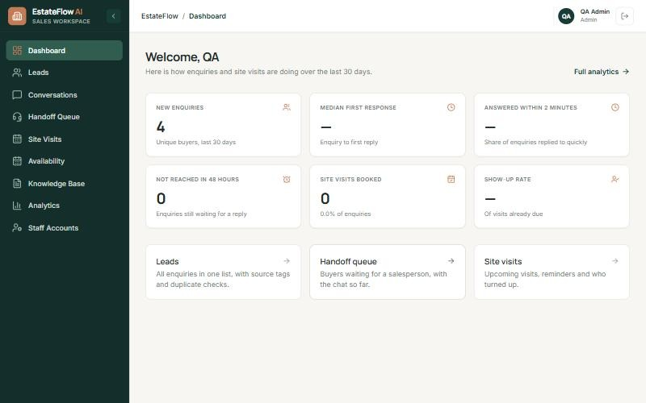
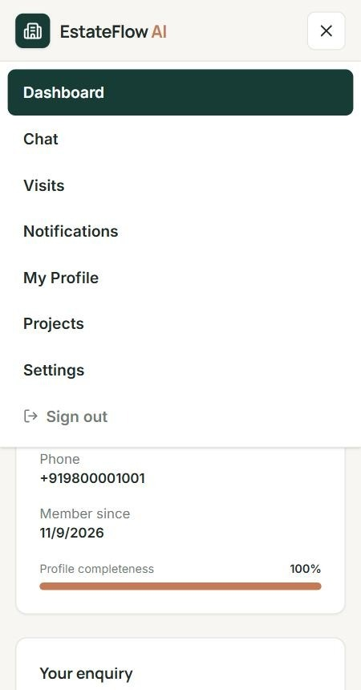
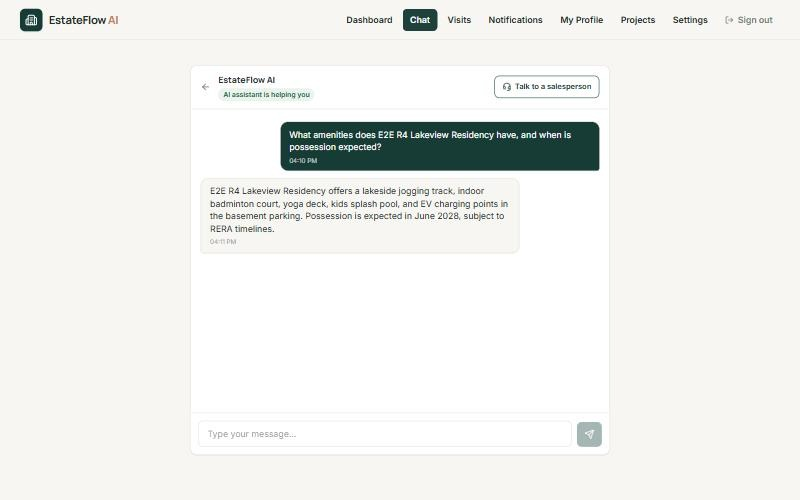
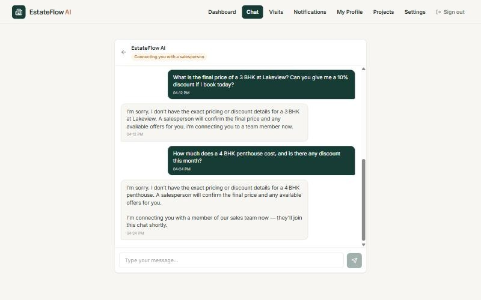

# EstateFlow AI

AI-assisted lead management and site-visit automation for residential property developers. Every enquiry is captured in one place, answered at once in **English, Hindi or Gujarati**, qualified from an approved fact sheet, and booked into a **real free slot**. Serious buyers are handed to a named salesperson with the full chat.

**Docs:** [Technical design](docs/EstateFlow_Technical_Design_Document.docx) · [Deployment & demo logins](deployment.md)

## Demo Steps  

| | URL |
|---|---|
| Web app (Vercel) | <https://real-estate-phi-lemon.vercel.app> |
| API (Render) | <https://realestate-hlyl.onrender.com> |

No real messages or emails are sent: email is set to `log` and WhatsApp/SMS is simulated. If the first request is slow, the API is waking up; wait a few seconds and retry.

### How to log in

There are two separate sign-in pages. Use a private window (or a different browser profile) for each role, because sessions are cookie-based and signing in as a second role in the same window replaces the first.

| Role | Sign in at | Email | Password |
|---|---|---|---|
| **Admin** | [/login](https://real-estate-phi-lemon.vercel.app/login) | `admin-smoke@estateflow.ai` | `Hello@1234` |
| **Sales head (manager)** | [/login](https://real-estate-phi-lemon.vercel.app/login) | `test2@estateflow.ai` | `09876543` |
| **Sales executive** | [/login](https://real-estate-phi-lemon.vercel.app/login) | `test@estateflow.ai` | `12345678` |


> These are demo-only accounts created for review.

### What each role can do

| Menu item | Admin | Sales head | Sales executive |
|---|:---:|:---:|:---:|
| Dashboard (response time, visits, show-up rate) | yes | yes | yes |
| Leads (sources, duplicates, status) | yes | yes | yes |
| Conversations (chat transcripts) | yes | yes | yes |
| Conversations → Flagged for review | yes | yes | no |
| Handoff Queue (chats passed to a person) | yes | yes | yes |
| Site Visits (view, reschedule, mark attended / no-show) | yes | yes | yes |
| Analytics | yes | yes | yes |
| Availability (working hours, leave, visit capacity) | yes | yes | no |
| Knowledge Base (projects, fact sheets, approve / publish) | yes | no | no |
| Staff Accounts (create / disable staff) | yes | no | no |

The **buyer** has a separate portal with: Dashboard, Chat, Visits, Notifications, My Profile, Projects and Settings. Buyers cannot see any staff page, and staff accounts cannot sign in at `/customer/login`.

### Suggested end-to-end walk-through

Follow the roles in this order; each step uses what the previous one created.

1. **Buyer** – sign in at `/customer/login`, then open **Projects** to pick a project and **Chat**.
   - Ask about amenities or location in English, Hindi or Gujarati. The reply comes only from the approved fact sheet and stays in your language.
   - Ask "What is the final price? Any discount?" The assistant refuses to quote a price and hands the chat to a salesperson.
   - Say "I want to visit this Saturday". It lists real free times. Choose one, then reply "yes" to book. It confirms only after the booking is saved.
   - Open **Visits** to see the booking (location, map link, RERA number). You can reschedule or cancel from there.
   - Type `STOP` to test the opt-out: no further reminders or messages are sent.


2. **Sales executive** – sign in at `/login`.
   - **Handoff Queue**: open the chat from step 1 and see the summary, source, qualification and full transcript. Reply to the buyer (the AI stays silent once a person takes over).
   - **Site Visits**: find the visit booked above and mark it attended or no-show.


3. **Sales head** – sign in at `/login`.
   - **Dashboard**: first response time, answered within 2 minutes, not reached in 48 hours, visits booked, show-up rate.
   - **Conversations → Flagged for review**: chats the AI escalated (price asks, complaints, unanswered questions). Pick a date to review.
   - **Leads**: source tags and duplicate review (fuzzy matches are flagged, never merged automatically).
   - **Availability**: the working hours and capacity that decide which slots buyers see.


4. **Admin** – sign in at `/login`.
   - **Knowledge Base**: create a project, upload a fact sheet, approve and publish it. The chat answers only from approved, published fact sheets.
   - **Staff Accounts**: create or disable staff and check that an executive cannot open admin pages.

## Features

- **One lead list** from portals, social ads, hoarding calls, website and CSV, with source tags and duplicate detection (fuzzy matches are flagged, never auto-merged).
- **AI assistant** that answers only from approved fact sheets, never quotes a final price or discount, asks for missing needs (BHK, budget, purpose) and escalates what it cannot answer.
- **Booking in chat or on screen** against real availability: working hours, leave, capacity and existing visits. Concurrency-safe and idempotent, so no double booking.
- **Reminders** 1 day and 2 hours before a visit, with location map link and RERA number; consent and opt-outs are re-checked at send time.
- **Handoff** to a named executive with a summary, qualification and transcript.
- **Immediate first contact** for new enquiries (simulated channel), and a daily **flagged-chat review** for the sales head.
- **Dashboard**: first response time, answered within 2 minutes, not reached in 48 h, visits booked, show-up rate.
- **Admin tools**: fact-sheet versions and approval, project listing, executive availability, staff accounts, role-based access (buyer, executive, manager, admin).

## Screenshots

| Sales dashboard | Buyer on a phone |
|---|---|
|  |  |

| Answers only from the fact sheet | Price questions go to a salesperson |
|---|---|
|  |  |

## Architecture

```
Next.js (Vercel) ──/api/v1──▶ FastAPI (modular monolith) ──▶ PostgreSQL + pgvector
                                   │                      ──▶ Redis (rate limits, locks)
                                   ├─ Groq LLM + local multilingual embeddings
                                   └─ Workers: reminders · customer email
```

| Layer | Stack |
|---|---|
| Frontend | Next.js, TypeScript, Tailwind CSS |
| Backend | FastAPI, Pydantic, SQLAlchemy, Alembic |
| Data | PostgreSQL with pgvector, Redis |
| AI | Groq (LLM), sentence-transformers (retrieval) |
| Tests | Pytest |

The AI is a fixed pipeline (extract, retrieve, answer, guardrails) that calls validated backend services; it never runs SQL or confirms an action before the backend does.

## Quick start

```bash
# Backend
pip install -r backend/requirements.txt
cp backend/.env.example backend/.env.local        # fill in values
alembic -c backend/alembic.ini upgrade head
python -m backend.cli.seed_demo                   # demo accounts + sample enquiries
python -m uvicorn backend.main:app --reload --port 8000
python -m backend.workers.reminder_worker         # separate terminal
python -m backend.workers.customer_email_worker   # separate terminal

# Frontend
cd frontend && cp .env.example .env.local && npm install && npm run dev
```

Open <http://localhost:3000>. Full setup, environment variables and demo logins are in [deployment.md](deployment.md).

## Project layout

```
backend/    api/ (thin routes) · services/ · ai/ · models/ · workers/ · migrations/ · tests/
frontend/   app/ (staff, buyer and public pages) · components/ · lib/
docs/       technical design document
```

## Testing

```bash
pytest backend/tests          # run against a separate test database, never production
```

## Scope and next steps

Real WhatsApp/SMS, payments and voice calling are out of scope (messages are simulated and logged; email defaults to `log`). Next: cost per visit by source, a WhatsApp channel with opt-in templates, and a "reviewed" state for flagged chats.

